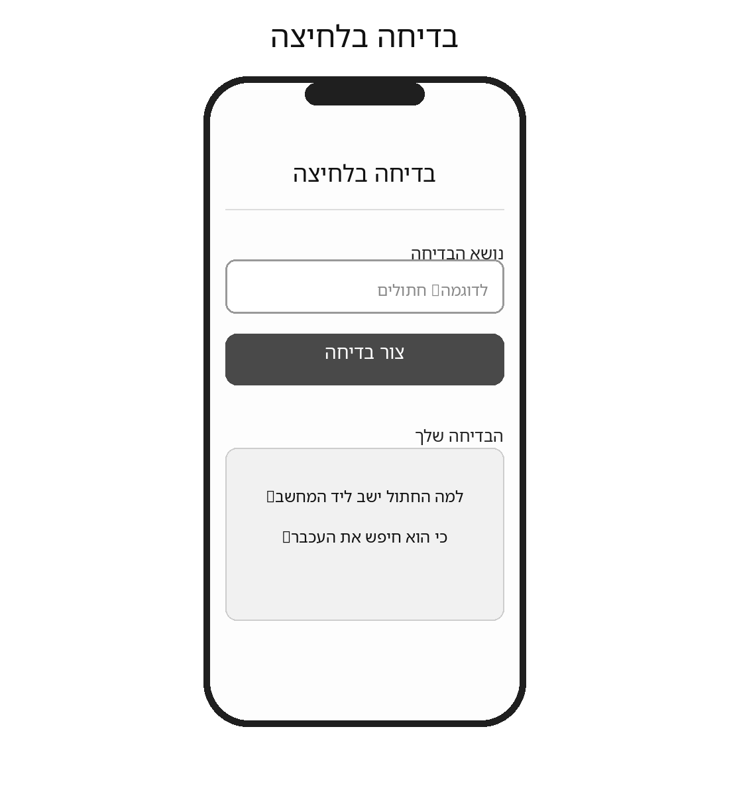
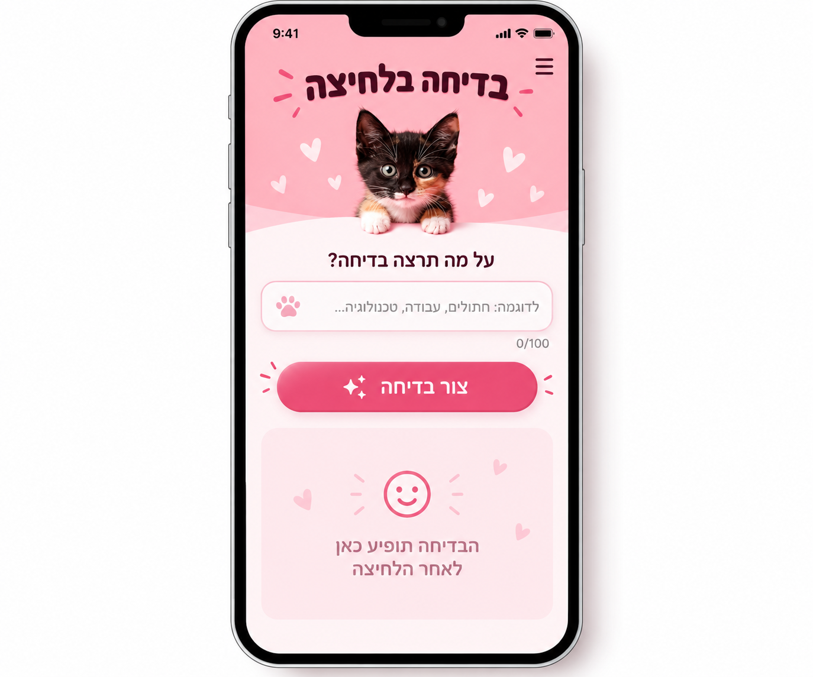

# DESIGN — בדיחה בלחיצה

מסמך זה מתאר את מימוש העיצוב של אפליקציית המובייל **"בדיחה בלחיצה"**. דרישות ההתנהגות והאילוצים מוגדרים ב-`PRD.md`; כאן מתועדים מבנה המסך והשפה החזותית בלבד.

**סדר עדיפויות במקרה של אי־התאמה:** ה-PRD קובע אילו יכולות מותרות; ה-Wireframes קובעים את מבנה המסך ורכיביו; ה-Style Guide קובע את השפה החזותית; ה-Mockups מדגימים את המראה הרצוי. אין להוסיף פונקציונליות בעקבות אלמנט דקורטיבי בתמונה.

## 1. Screens – מסכי האפליקציה

### 1.1 בדיחה בלחיצה — המסך היחיד

**מטרת המסך:** לאפשר הזנת נושא, יצירת בדיחה והצגתה מיידית באותו מסך.

**מבנה ותוכן — לפי ה-Wireframe, מלמעלה למטה:**

1. **כותרת ראשית:** "בדיחה בלחיצה", בראש התצוגה, בתוך אזור כותרת ורוד שכולל את תמונת החתלתול (כמו ב-Mockup).
2. **שדה נושא:** תווית "נושא הבדיחה" (לפי ה-Wireframe) ושדה קלט יחיד עם טקסט דוגמה. השדה מאפשר עד 100 תווים ואינו חובה. מתחת לשדה מוצג **מונה תווים** בפורמט `0/100` (כמו ב-Mockup).
3. **כפתור פעולה מרכזי:** "צור בדיחה", מתחת לשדה, ברוחב בולט ובהיררכיה חזותית ראשית. מתחתיו — אזור להודעות שגיאה ו-Offline (ריק כשאין הודעה).
4. **אזור בדיחה:** כותרת אזור "הבדיחה שלך" (לפי ה-Wireframe) ואחריה כרטיס תוכן בעל פינות מעוגלות. לכרטיס כמה מצבי תוכן — ראו 1.4. אלה מצבים של **אותו רכיב באותו מסך**, לא מסכים נפרדים.

**הדגשים במראה הסופי:** כותרת כהה על רקע ורוד, תמונת חתלתול כחלק מאזור הכותרת, שדה קלט לבן בעל מסגרת ורודה עדינה, כפתור ורוד בולט, וכרטיס בדיחה ורדרד.

**פעולות וניווט:** המשתמש מזין נושא, לוחץ על "צור בדיחה", וקורא את התוצאה באותו אזור. לחיצה נוספת מחליפה את הטקסט באותו כרטיס. חיווי הטעינה "מכין לך בדיחה..." והודעות השגיאה או ה-Offline מופיעים בתוך המסך הקיים, ללא מעבר למסך אחר; בתקופת טעינה הכפתור מושבת בהתאם ל-PRD.

**הבהרת סתירה חזותית:** ב-Mockup מופיע אייקון תפריט (שלושה קווים) שלא קיים ב-Wireframe ושסותר את דרישת ה-PRD למסך יחיד ללא תפריטים. **אין לממש תפריט או אייקון תפריט פעיל.** גם הלבבות, טביעת הכף והניצוצות הם קישוטים בלבד ואינם פעולות חדשות.

### 1.2 מבנה ניווט

לאפליקציה מסך אחד בלבד. אין Navigation Bar, תפריט, קישורי ניווט או מסכי משנה. כל המצבים מוצגים בתוך המסך הראשי.

### 1.3 טקסטים בממשק (Microcopy)

כל הטקסטים שמופיעים במסך. אין להוסיף או לשנות טקסטים שאינם בטבלה בלי אישור.

| רכיב | טקסט |
|---|---|
| כותרת ראשית | בדיחה בלחיצה |
| תווית השדה | נושא הבדיחה |
| טקסט דוגמה בשדה (Placeholder) | לדוגמה: חתולים, עבודה, טכנולוגיה... |
| מונה תווים | מספר התווים שהוזנו מתוך 100, למשל `37/100` |
| כפתור | צור בדיחה |
| כותרת אזור הבדיחה | הבדיחה שלך |
| כרטיס — מצב ריק | הבדיחה תופיע כאן אחרי הלחיצה |
| כרטיס — טעינה | מכין לך בדיחה... |
| הודעת שגיאה (כל כשל: שרת, AI, רשת, המתנה ארוכה מדי, תשובה לא תקינה) | לא הצלחנו ליצור בדיחה כרגע. אפשר לנסות שוב. |
| הודעת Offline | נדרש חיבור לאינטרנט כדי ליצור בדיחה |

### 1.4 מצבי כרטיס הבדיחה והודעות

| מצב | מה מוצג בכרטיס | מתחת לכפתור | הכפתור |
|---|---|---|---|
| **ריק** (לפני הבדיחה הראשונה) | איור סמיילי, לבבות קטנים והטקסט "הבדיחה תופיע כאן אחרי הלחיצה" — כמו ב-Mockup | — | פעיל |
| **טעינה** | "מכין לך בדיחה..." במקום התוכן הקודם, עם אנימציה עדינה (למשל שלוש נקודות מהבהבות) | — | מושבת |
| **בדיחה** | טקסט הבדיחה (Body, ‏Charcoal), בכיווניות לפי שפת הבדיחה | — | פעיל |
| **שגיאה** | התוכן שהיה לפני הלחיצה חוזר: הבדיחה הקודמת, או המצב הריק אם לא הייתה | הודעת השגיאה | פעיל |
| **Offline** | התוכן שהיה לפני הלחיצה נשאר | הודעת ה-Offline | פעיל |

- הודעות שגיאה ו-Offline מוצגות בטקסט Body בצבע Charcoal, ממורכזות, ונעלמות בלחיצה הבאה על הכפתור.
- אין מודאלים, חלונות קופצים או הודעות Toast.

### 1.5 נכסים חזותיים נדרשים (מסופקים על ידי בעל המוצר)

| קובץ | תיאור | נדרש עד | סטטוס |
|---|---|---|---|
| `spec/assets/kitten.png` | צילום חתלתול לאזור הכותרת, רצוי עם רקע שקוף, ברוחב 600px לפחות. יש לוודא שיש רישיון שימוש (צילום עצמי, תמונה חופשית לשימוש מסחרי, או תמונה שנוצרה ב-AI). | Milestone 1 | ⏳ טרם סופק |
| `spec/assets/app-icon.png` | אייקון ריבועי לאפליקציה, 512×512 לפחות, עם עיצוב פשוט שנשאר ברור גם בגודל קטן (למשל פני החתלתול על רקע ורוד). ממנו מופקים כל גדלי האייקון. | Milestone 3 | ⏳ טרם סופק |

כשהקבצים מסופקים, יש לעדכן בטבלה את הסטטוס ואת מקור הרישיון. עד אז, ה-Milestone שזקוק לקובץ ייעצר ויבקש אותו.

## 2. Style Guide – השפה העיצובית

### 2.1 Color Palette

הפלטה נגזרת מצבעי החתלתול, הרקע הוורוד והדוגמאות בלוח ה-Style Guide:

| צבע | HEX | שימוש עיקרי |
|---|---|---|
| Blush Pink | `#F7AEB8` | צבע מותג חם, אזורי הדגשה ורקע הכותרת |
| Pale Pink | `#FBD6DC` | משטחי רקע רכים וכרטיס הבדיחה |
| Cream | `#FFF4ED` | רקע מסך ומשטחים ניטרליים |
| Charcoal | `#2E2424` | כותרות וטקסט ראשי |
| Cocoa | `#8B5E4D` | טקסט משני ופרטים משלימים |
| White | `#FFFFFF` | שדות קלט ומשטחים בהירים |
| Raspberry | `#C93A6B` | **רקע הכפתור הראשי** (טקסט לבן) והדגשות קטנות |

**צבע הכפתור:** ב-Mockup הכפתור בגוון ורוד חזק יותר מ-Blush Pink. טקסט לבן על Blush Pink כמעט לא קריא (ניגודיות של כ-1.8:1), ולכן נוסף הצבע Raspberry. הוא כהה מעט מהגוון שב-Mockup, כדי שהטקסט הלבן יעמוד בניגודיות של כ-4.9:1. הכפתור בצבע אחיד, ללא מעבר צבע (Gradient). כשהכפתור מושבת, הוא מוצג באותו צבע בשקיפות של 50%.

בחלק מהמשטחים ב-Mockup מופיעים מעברי גוון עדינים. מותר להשתמש במעבר עדין בין Blush Pink ל-Pale Pink ברקע אזור הכותרת. אין להשתמש במעברים מתחת לטקסט.

### 2.2 Typography

- **Primary Font:** `Heebo` — גופן הממשק המרכזי לעברית.
- **Secondary Font:** `Assistant` — חלופה משלימה לטקסטים משניים במקרה הצורך.
- **Heading H1:** ‏36px, ‏Heebo **Black (900)** — שם האפליקציה. המשקל הכבד מתקרב למראה העבה והשובב של הכותרת ב-Mockup וב-Style Guide, בלי להוסיף גופן שלישי.
- **Subheading H2:** ‏24px, Bold — כותרות אזורים ושאלת ההנחיה.
- **Body:** ‏16px, Regular — טקסט רגיל, נושא ובדיחה.
- **Caption:** ‏14px, Regular — מידע משני כגון מונה התווים.

יש לשמור על מדרג משקלים וגדלים ברור; גודל הבדיחה בפועל צריך להישאר קריא גם כאשר היא ארוכה ונדרשת גלילה. הגופנים נכללים בפרויקט עצמו ומוצגים נכון גם Offline (ARCHITECTURE, ‏ADR-4). Placeholder ומונה התווים מוצגים בצבע Cocoa.

### 2.3 UI Style

- **Primary Button:** כפתור גדול, רחב, בצבע Raspberry, בעל פינות מעוגלות מאוד וטקסט לבן מודגש (לפחות 18px); תווית הפעולה היא **"צור בדיחה"**. ניצוצות סמוכים משמשים הדגשה חזותית ולא כפתורים.
- **Text Input:** רקע לבן, מסגרת ורודה דקה, פינות מעוגלות, טקסט ו-Placeholder מיושרים לימין, בהתאמה ל-RTL. טביעת כף בתמונה היא קישוט, לא לחצן.
- **Joke Card:** משטח ורוד בהיר בעל פינות מעוגלות; טקסט הבדיחה מוצג בתוך הכרטיס. ה-Placeholder המאויר שב-Mockup הוא מצב התוכן הריק של אותו כרטיס.
- **Icons:** סגנון פשוט, רך ומעוגל. לבבות, ניצוצות, סמיילי וטביעות כף יכולים לשמש **קישוטים בלבד** במקומות המשתקפים ב-Mockup; אין להוסיף פעולות העתקה, לייק או ניווט שלא אושרו.
- **Navigation / Menus:** אינם קיימים במוצר. דוגמת התפריט שב-Style Guide אינה רלוונטית למסך היישום בפועל.

### 2.4 Visual Style

- **אווירה:** חמודה, אופטימית ומשעשעת, בהשראת צילום החתלתול על רקע ורוד פסטלי.
- **צורות ופינות:** כרטיסים ושדות בעלי פינות רכות; כפתור פעולה בצורת קפסולה. ה-Style Guide ממליץ על רדיוס אופייני בטווח **16–24px** לרכיבים מעוגלים.
- **צללים וקווי מתאר:** צללים מפוזרים ועדינים המעניקים עומק, ללא מסגרות כבדות. לשדות מסגרת ורודה קלה.
- **Spacing:** מרווחי נשימה נדיבים בין כותרת, שדה, כפתור וכרטיס; לשמור על סדר אנכי נקי ולא לדחוס את הטקסט.
- **Layout:** עמודה אחת, במרכז מסך Smartphone, עם יישור מותאם RTL ושמירה על שטח גלוי למסירת התוצאה. בדיחות ארוכות גוללות עם התוכן במקום להרחיב רכיבים מעבר לרוחב המסך.
- **Imagery:** צילום חתלתול מתוק באווירה רכה, על רקע ורוד, בראש המסך — הקובץ `spec/assets/kitten.png` (ראו 1.5). עיטורים קטנים של לבבות וסמלים ידידותיים ממומשים כאיורים פשוטים (SVG או CSS), ולא כתמונות נוספות. יש לשמור על קריאות הטקסט מעל רקעים וצילומים.

### 2.5 שפה וכיווניות

- **שפת ממשק:** עברית בכל הכותרות, התוויות, הלחצנים והודעות המערכת.
- **כיווניות מסמך וממשק:** `RTL`; תוויות השדות והטקסטים בעברית מיושרים לימין. שם האפליקציה וכותרת ההדגשה יכולים להיות ממורכזים כפי שמוצג בתמונות.
- **תוכן הבדיחה:** שפת הבדיחה תלויה בשפת הנושא בהתאם ל-PRD; את טקסט הבדיחה עצמו יש להציג בכיווניות המתאימה לתוכן (עברית RTL, אנגלית LTR), מבלי לשנות את כיווניות שאר הממשק.
- **Responsive:** העיצוב מיועד למסכי מובייל בלבד; לשמור על פרופורציות הכרטיסים, ריווחים וטקסט קריא בגדלי מסך שונים, ללא יצירת פריסת Desktop חדשה.

---

**היקף העיצוב:** מסך יחיד בלבד, ללא תפריטים, מסכים נוספים או פיצ'רים שלא הוגדרו ב-PRD. התייחסות לתמונות היא ויזואלית בלבד; ההתנהגות נשארת כפי שהוגדרה ב-PRD.
